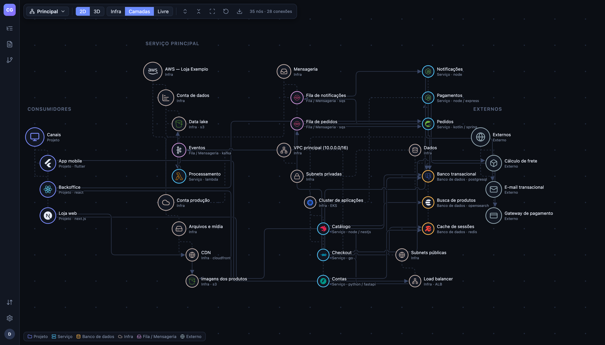

# Atlas

[](https://github.com/joaodobread/atlas/actions/workflows/ci.yml)
[](LICENSE)
[](https://github.com/joaodobread/atlas/pkgs/container/atlas)

O Atlas é um mapa vivo da arquitetura: mostra como projetos, módulos, bancos, filas e infraestrutura se comunicam
(em 2D/3D, agrupado pela infra), responde perguntas sobre a documentação com busca híbrida e RAG, faz a introspecção
dos repositórios do GitHub para propor o grafo e avaliar a saúde de cada um (CI, testes, segurança, PRs parados,
dependências) e recebe métricas de qualidade direto do CI. É self-hosted e open source.



## Início rápido

Com a imagem publicada no GHCR (Postgres e storage S3 sobem junto pelo compose):

```bash
git clone https://github.com/joaodobread/atlas && cd atlas
export APP_SECRET="$(openssl rand -base64 48)" APP_IMAGE=ghcr.io/joaodobread/atlas:latest
docker compose -f containers/compose.yaml --profile app pull app    # o serviço tem `build:`, então o `up` não baixa a imagem sozinho
docker compose -f containers/compose.yaml --profile deps --profile app up -d --no-build
```

Ou construindo a imagem localmente:

```bash
docker compose -f containers/compose.yaml --profile deps --profile app up -d --build
```

Abra http://localhost:3001 e crie o administrador. Funciona igual com `podman compose`.

Para ver um exemplo pronto (uma loja virtual fictícia na AWS, como no print), importe
[`examples/demo/loja-exemplo.json`](examples/demo/loja-exemplo.json) em _Importar/Exportar_.

> **Antes de expor em produção:** troque as credenciais de exemplo do Postgres e do storage (`.env.example` e
> `containers/compose.yaml`), defina um `APP_SECRET` próprio (32+ caracteres) e guarde-o junto com os backups — ele
> cifra as configurações sensíveis. Veja [`containers/README.md`](containers/README.md) para RDS, TLS e buckets.

Quer contribuir? Leia o [CONTRIBUTING.md](CONTRIBUTING.md). Encontrou uma vulnerabilidade? Siga o
[SECURITY.md](SECURITY.md) — nunca abra uma issue pública. Licenciado sob [AGPL-3.0](LICENSE).

## Rodando em desenvolvimento

`make dev` faz tudo abaixo de uma vez (`make help` lista os outros alvos: `app`, `down`, `logs`, `check`, `reset-db`…).

Requisitos: Node 24 e Docker **ou** Podman (com compose).

```bash
docker compose -f containers/compose.yaml --profile deps up -d   # Postgres 17 + pgvector e storage S3 (RustFS)
cp .env.example .env                                              # já aponta para os containers acima
npm install
npm run dev                                                       # API :3001 + Vite :5173
```

- Dados ficam no **Postgres** (`DATABASE_URL`); arquivos (uploads, relatórios do CI, cache do modelo de embeddings)
  no **bucket privado** e o que for compartilhado no **bucket público** (S3 ou compatível).
- Migrando de uma instalação antiga em SQLite: `npm run migrate:sqlite -- --file data/graph.db` (mantenha o mesmo
  `data/secret.key`/`APP_SECRET` para as configurações criptografadas continuarem legíveis).

## Produção

Veja [`containers/README.md`](containers/README.md): imagem OCI (não-root, filesystem somente leitura), compose
tudo-em-um ou só a app apontando para serviços gerenciados (**RDS/Aurora com TLS `verify-full`**, S3/R2…).
Em produção `APP_SECRET` (32+ caracteres) é obrigatório.

## Qualidade

```bash
npm run check          # typecheck + oxlint (type-aware) + oxfmt --check + testes com cobertura (mínimo 90%)
npm test               # Vitest: unit, integração (Postgres real) e front (happy-dom)
npm run lint           # oxlint
npm run format         # oxfmt
```

Os testes de integração criam e migram o banco `<nome>_test` no Postgres de `TEST_DATABASE_URL`
(padrão: o do compose). O CI (`.github/workflows/ci.yml`) roda tudo isso e constrói a imagem.

## Primeiro acesso, usuários e segurança

Não há usuário padrão: na primeira abertura a tela pede para criar o **administrador**.
Depois, em _menu do usuário → Usuários_, crie contas com papel **Leitor** (vê e busca), **Editor** (também edita)
ou **Administrador** (também gerencia usuários, LLM e pastas monitoradas).

- Senhas com `scrypt`; sessão em cookie HttpOnly (use `COOKIE_SECURE=true` atrás de HTTPS); bloqueio após 5 erros de login.
- Cabeçalhos de segurança (CSP restritiva, sem iframes, HSTS com HTTPS), limite de requisições por IP, proteção CSRF
  por header, `TRUST_PROXY` para o proxy reverso e TLS no banco (`DATABASE_SSL=verify-full`).
- No primeiro login cada usuário vê um **tutorial** guiado (dá para rever em _Configurações → Minha conta_).
- **Tokens de API** (_Minha conta_) para scripts/LLM: `Authorization: Bearer cgt_…`, com as permissões do dono.
- **LLM configurado pela interface** (_Configurações de LLM_): provedor, modelo, URL, chave e extração de menções.
  A configuração é gravada **criptografada (AES-256-GCM)**. A chave mestra vem de `APP_SECRET` (obrigatório em produção)
  ou, em dev, é gerada em `data/secret.key` — **guarde-a junto com os backups do banco**.

## Conceitos

- **Nó**: projeto, serviço, banco, infra, fila, externo ou módulo. Hierarquia de profundidade arbitrária.
- **Interface**: o que um nó expõe (endpoint, tabela, tópico, método).
- **Conexão** (dirigida): origem chama destino, opcionalmente numa interface do destino.
  Pode **implementar** a saída de um ancestral (ex.: `UsersModule → MySQL` implementa `Node API → MySQL`).
- **Local de chamada**: arquivo/linha/símbolo onde a chamada acontece.

Na cena (3D ou 2D, alternável na barra):

- **Clique** num nó seleciona e **foca**: só ele, seus submódulos e os nós com que se comunica ficam visíveis
  (vizinhos aparecem em itálico). Saia pela barra de foco, pela trilha ou com **Esc**.
- **Clique duplo** expande/recolhe. Conexões de nós recolhidos sobem para o ancestral visível.
- No 2D: arraste o fundo para mover, roda para zoom, arraste um nó para reposicioná-lo.
- **Ícones**: escolha no seletor (marcas como MySQL, Node, Kafka… ou genéricos). Em "Automático" o ícone vem da tecnologia
  (ex.: `node / express` → Node.js) ou do tipo.

## Documentos e RAG

Aba **Documentos** no painel esquerdo:

- **Entrada**: upload de `.md`, **pastas monitoradas** (reindexa sozinho ao salvar) ou `POST /api/documents` / `POST /api/documents/import`.
- Cada `.md` é dividido por seção (com faixa de linhas), indexado em **FTS5** (busca textual sem acento) e **vetorizado localmente**
  (`Xenova/multilingual-e5-small`, baixado na 1ª vez para `data/models`, nada sai da máquina).
- **Menções**: trechos que citam um nó são ligados a ele — por nome exato, por **casamento aproximado** ("NodApi" → "Node API")
  e, com LLM configurado, por **análise do LLM** em segundo plano (variações, abreviações, referências indiretas). A busca mostra os **módulos afetados**,
  destaca-os no grafo, e o painel do nó lista "Mencionado em documentos".
- Busca **híbrida** (texto + semântica, fundidas por RRF), só texto ou só semântica.
- **Perguntar**: manda ao LLM os trechos encontrados + os fatos do grafo sobre os módulos afetados (quem chama quem) e devolve a resposta
  com citações `[n]` clicáveis. Configure o provedor em _Configurações de LLM_ (o `.env` só define o valor inicial):
  - `anthropic` (Claude via SDK oficial; padrão `claude-opus-5-5`, com fallback automático em caso de recusa),
  - `openai-compatible` (OpenRouter, OpenAI, Ollama, LM Studio, vLLM…).

- **Modelo do grafo na busca**: cada nó vira um documento gerado (o que é, onde fica, interfaces, quem chama, quem o chama
  e os locais no código), regenerado automaticamente a cada mudança. Perguntas como "quem usa o Redis?" ou "onde é feito o Pix?"
  funcionam mesmo sem `.md`, e esses trechos entram no contexto do LLM. Na busca aparecem com a marca **modelo** e abrem o nó no grafo.

Busca textual pelo full-text do Postgres (sem acentos) e semântica pelo **pgvector**, fundidas por RRF. Exemplos em `examples/docs` (adicione a pasta como monitorada).

## Repositórios do GitHub e métricas de CI

**Introspecção.** Em “Integração com o GitHub” (menu do usuário, admin), informe a organização/usuário e um token
fine-grained somente leitura (_Contents_ e _Metadata_; fica criptografado). Na tela **Repositórios** (barra lateral): “Sincronizar lista” e
“Analisar”; a grade agrupa por sistema (nó do grafo ligado), com filtros por faixa de nota e categoria reprovada. Para cada repositório o servidor:

1. lê a árvore e arquivos-chave pela API (README, manifests, oni.yaml, serverless, Dockerfile, workflows, configs) —
   nunca `.env`, e segredos são removidos antes de guardar ou mandar ao LLM;
2. consulta fontes públicas: vulnerabilidades (OSV), atraso das dependências em libyears (npm/Go) e suporte do runtime
   (endoflife.date);
3. resume com o LLM configurado (ou heurística, sem LLM) e grava um documento `github/<org>/<repo>.md` no RAG;
4. calcula o scorecard (CI, testes, segurança, guardrails, processo e documentação, com pesos). Regras: “falhou” só
   com evidência; não publicar algo que se aplica (ex.: cobertura) vale 0; “desconhecido” não muda a nota, só baixa a
   confiança; checks de workflow (pull_request_target perigoso, permissions, actions sem SHA), binários versionados,
   proteção do branch e processo dos últimos 90 dias (revisão, push direto, issues, concentração de autoria, PRs
   parados) também contam. Cada cálculo entra no histórico, que quebra a linha quando a versão das regras muda;
5. propõe nós e conexões — só entram no grafo quando alguém clica em **Aplicar no grafo**.

Sem commits novos, a análise é reaproveitada (use “Forçar” para refazer).

**Métricas pelo workflow.** Cada repositório pode enviar cobertura (Istanbul, lcov, Go, Cobertura), JUnit (unit,
integração, e2e) e SARIF (SAST, DAST, SCA, segredos — Semgrep, CodeQL, ZAP, Trivy, gitleaks, Rainforest…) com a action
em [`integrations/github-action`](integrations/github-action/README.md), ou com um `POST /api/metrics` de qualquer CI
(token de API de um usuário editor, permissão `metrics:write`). O servidor interpreta, guarda o histórico e recalcula a nota.

## Vários grafos e exportação

- O seletor no canto da cena troca, cria, renomeia e exclui **grafos** independentes (cada um com seus nós e conexões).
- Na tela Repositórios, selecione repositórios e use **Gerar grafo**, escolhendo a profundidade:
  - **Rápida** (sem LLM): o nó de cada repositório e os bancos, filas, infra e externos ligados a ele;
  - **Média** (LLM): módulos, tudo com que o repositório se comunica e recursos descobertos no README/configurações;
  - **Completa** (LLM + varredura do código, consome muitos tokens): a média mais cada chamada externa (HTTP, banco,
    fila, cache, SDKs) com arquivo, linha e trecho de código, ligada ao destino no grafo;
  - **Máxima** (LLM + **todos** os arquivos de código, sem limite; a mais cara e demorada): guarda o **bloco inteiro** (função/método) de cada chamada,
    a **interface usada** no destino (endpoint, tabela, tópico, bucket) como conexão própria e o que cada módulo **expõe**
    (rotas HTTP, consumidores de fila/tópico, jobs) como interfaces do módulo, com arquivo e linhas do handler.
    Repositórios sem análise na profundidade pedida são (re)analisados antes; o grafo inclui as caixas de infra que os contêm.
- Análises longas mostram o **progresso por etapa** (coleta, LLM, leitura do código, mapeamento, nota), com contador,
  barra e tempo decorrido, na janela "Gerar grafo" e na tela Repositórios.
- O botão de download da cena exporta o diagrama 2D inteiro em **PNG** ou **SVG** (vetor).

## Import/Export (para LLM)

`GET /api/export` e `POST /api/import` usam o mesmo formato (validado por `exchangeDocumentSchema` em `shared/schemas.ts`):

```json
{
  "mode": "merge",
  "nodes": [
    { "ref": "api", "name": "Node API", "kind": "service", "tech": "node", "interfaces": [{ "name": "GET /users", "type": "http" }] },
    { "ref": "api.users", "name": "UsersModule", "kind": "module", "parent": "api" }
  ],
  "connections": [
    { "ref": "api->db", "from": "api", "to": "MySQL", "protocol": "sql" },
    {
      "from": "api.users",
      "to": "MySQL",
      "interface": "users",
      "implements": "api->db",
      "callSites": [{ "file_path": "src/users/repo.ts", "line": 10, "symbol": "UsersRepo.findAll" }]
    }
  ]
}
```

- `merge` é idempotente (nós casam por pai + nome); `replace` apaga tudo antes.
- `parent`/`from`/`to` aceitam um `ref` do documento **ou** o caminho de um nó existente (`Projeto/Modulo`).
- Interface inexistente citada numa conexão é criada no destino.
